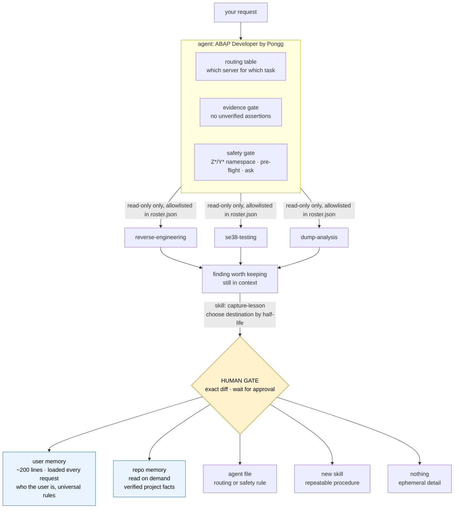

# abap-copilot-kit

A reproducible VS Code Copilot setup for SAP/ABAP work, built on three rules:

1. **Route, don't overlap.** One task, one MCP server. A per-task table, not a global ranking,
   because a priority list gets skipped the moment the top tool lacks the operation.
2. **Never guess.** Every environmental claim needs a tool result from the current session.
   A hypothesis is fine when labelled; a guess stated as fact is not.
3. **The human decides.** AI detects drift and proposes changes. You approve every file edit.

SAP tooling changes constantly — a server updates, an extension ships new tools, an installer
rewrites its agents. This workspace is built to stay correct when that happens, instead of
accumulating instructions that were true once.

**Scope: Windows.** The credential layer is Windows Credential Manager, the launch paths are
`%USERPROFILE%`, and the scripts are PowerShell 5.1. The agent, skill and hook files are
portable; the tooling is not.

**Contents.** [What is here](#what-is-here) · [Read this first](#one-fact-worth-reading-before-anything-else) · [Hooks](#hooks) · [Design](#design-in-one-diagram) · [Install](#install) · [Not here](#what-is-deliberately-not-here) · [Contract backup](#where-a-programs-contract-is-backed-up) · [Releasing](#releasing) · [Adapting](#adapting-it) · [License](#license)

## What is here

```
AGENTS.md          workspace contract: connection scope, access rules, session start
INDEX.md           one-screen map of this repository and of where memory really lives
agents/            custom agents with routing, safety and evidence gates
skills/            hand-written skills: mcp-surface-audit, capture-lesson, new-program
roster.json        delegation allowlist — read-only subagents only
hooks/             three detection-only hooks (see below)
docs/              architecture, tool routing, ownership, anti-hallucination
docs/reference/    lookup detail kept out of memory: ARC-1, skills, paths, hook contract,
                   detail levels (how much any output should say)
config-templates/  mcp.json, mcp-config.json (Copilot CLI), settings.json, arc1.env and
                   arc1-connections skeletons
memory-templates/  user profile template
templates/         yaml + README + spec + changes templates for a project, program or spec
tooling/           audit scripts: verify-all, measure-context, who-locks, surface snapshot,
                   sap-connection (logon list) + sap-secret (DPAPI) + sap-arc1-launcher,
                   sap-auth-probe (does the stored password still work),
                   workspace-sync (mirror a program contract into the private workspace repo),
                   install-kit (copy agents/tooling/skills into place on a machine)
backup/            recovery snapshot of user memory (nothing loads it)
Projects/          convention only - local notebook, gitignored, mirrored to a private repository
```

## One fact worth reading before anything else

**SAP connections are user-scoped, not workspace-scoped.** MCP servers live in
`%APPDATA%\Code\User\mcp.json`, ABAP FS destinations in `abapfs.remote` inside the user
`settings.json`, and the ADT MCP server in `adt.mcpServer.*`. Opening a folder selects
nothing: every configured server stays reachable from every folder, and several customers
can be reachable at once.

So a folder named after a project is documentation, not isolation. Confirm the system and
client explicitly before a read or a write. The only real pin would be a workspace-scoped
`.mcp.json` at the folder root, which means duplicating the server config — this repository
does not do that on purpose. `AGENTS.md` carries the same warning for the agent.

## Hooks

All three are detection only. None of them edits an agent, skill, or config file.

They live in **one** file, `~/.copilot/hooks/hooks.json`, in the Copilot CLI format:
`"version": 1`, camelCase event names, one `{"type":"command","command":"…"}` entry per event.
Three separate per-event files do not work — the loader requires a top-level `hooks` object.

A hook that injects context must answer in this shape:

```json
{ "hookSpecificOutput": { "hookEventName": "SessionStart", "additionalContext": "…" } }
```

`hookEventName` must equal the event that fired. A top-level `additionalContext` is ignored,
and a mismatched `hookEventName` is stripped.

| Event | Script | What it does | Context cost |
| --- | --- | --- | --- |
| `sessionStart` | `session-drift.cjs` | snapshots agents, both skill roots, MCP servers, extension tool counts; reports only what changed | `{}` when nothing changed |
| `subagentStart` | `subagent-rules.cjs` | prepends the namespace and evidence rules to a delegated task; restricts any agent not in `roster.json` | once per subagent |
| `postToolUseFailure` | `lesson-capture.cjs` | appends one evidence row per failed tool call | `{}` until the third identical failure |

> **Harness caveat.** VS Code documents `chat.useHooks` and `chat.hookFilesLocations` as
> *Local agent harness only*, while `chat.defaultToCopilotHarness` defaults to `true`. Confirm a
> hook actually fires in your harness before depending on it — `session-drift.cjs` rewrites
> `~/.copilot/state/surface.json` on every run, so its `takenAt` is the proof.

The subagent hook exists because a subagent runs in its own context: the coordinating
agent's rules do not reach it. Without this, delegating a write would bypass the `Z*`/`Y*`
namespace rule and the evidence gate. The default is restrictive, so an agent installed
tomorrow is read-only until a human adds it to the roster.


## Design in one diagram

The shape is deliberate: route, gate, capture, promote. The two memory layers are separate
because they have different half-lives and different costs.



**Both memory layers are outside this repository** and stay there: user memory is loaded from
the VS Code user data folder, repo memory from the per-workspace folder. Copying either into the
repository would create a second copy that nothing loads and nobody updates.

**The capture step is a skill, not a hook, on purpose.** The detection hooks cannot fire in the
Copilot harness, so a loop that depends on them never runs. `capture-lesson` drives the same loop
on purpose, while the finding is still in context.

## Install

Two ways in. **One command** places the mechanical parts — agents, tooling, this kit's skills — and
reports what it deliberately left alone. **The steps** are what remains: files a script cannot
place, because each needs a real value or a decision.

### One command

```powershell
powershell -File tooling\install-kit.ps1 -Check     # what would change
powershell -File tooling\install-kit.ps1           # copy what is missing
```

It copies `agents/*.agent.md`, every `tooling/*.ps1`, `*.js` and `*.json`, and this kit's three
skills. It is idempotent, and it refuses to overwrite a live file that differs — because the live
copy has been newer than the clone before, and a blind copy would quietly undo that. `-Check`
reports without copying; `-Force` overwrites once you have decided the clone is the newer one.

On a second machine, clone anywhere and run it. The kit root is resolved from
`$env:ABAP_KIT_ROOT`, then the `kit-root.txt` pin a previous run wrote beside the live scripts,
then the parent of `tooling\` — so no drive letter is baked in.

**Then check it.** `tooling/verify-all.ps1` is the audit this repository is held to. Run it after
installing, and again after any change:

```powershell
powershell -File tooling\verify-all.ps1                  # one line per check
powershell -File tooling\verify-all.ps1 -Detail full     # every file and every probe
```

It is read-only. A check it cannot evaluate prints `SKIP` with the reason rather than a pass — a
probe that reports success without evidence is worse than no probe.

### Steps

**1. Agents.** Copy `agents/*.agent.md` into `~/.copilot/agents/` (`%USERPROFILE%\.copilot\agents`
on Windows). Reload the window, then pick one from the agent dropdown.

**2. Skills.** Copy `skills/mcp-surface-audit`, `skills/capture-lesson`, and
`skills/new-program` into `~/.copilot/skills/`. Skills only load in a new chat session, so start
a fresh chat after copying.

**3. Roster.** Copy `roster.json` to `~/.copilot/roster.json`. Edit the file names to match the
agents you actually installed. An agent not listed there is not delegatable — that is the point
of an allowlist.

**4. MCP servers.** Copy `config-templates/mcp.json.template` to
`%APPDATA%\Code\User\mcp.json` and replace every `{{PLACEHOLDER}}`. The template is JSONC;
strip the comments if your editor refuses them.

**5. Credential — one password, both clients.** VS Code reads `~/.copilot/mcp.json`-style configs and
supports `${input:...}`, so it can ask for the password in a Quick Input every time a server
starts. The Copilot CLI has no such input — it can only pass `--env KEY=VALUE` — and its folder is
readable by another group on Windows, so a password in that file is not private.

The way out is to name a connection instead of listing credentials:

```powershell
tooling\sap-connection.ps1 -Add -Name gsd-110 -Url https://host:44381 -Client 110 -User <sap user>
powershell -ExecutionPolicy Bypass -File tooling\sap-secret.ps1 -Set -Key gsd-110_SAP_PASSWORD
```

`-Set` prompts once and stores the value in Windows Credential Manager. To keep a console window
from sitting next to the prompt, start it hidden — and name the interpreter by full path, because
this is a spawned process: `Start-Process "$PSHOME\powershell.exe" -WindowStyle Hidden -ArgumentList '-NoProfile','-ExecutionPolicy','Bypass','-File',$script,'-Set','-Key','gsd-110_SAP_PASSWORD'`.
Then point the client at the launcher — the password never appears in the config. Use the same
entry for both harnesses; only the key above it differs (`mcpServers` for the Copilot CLI,
`servers` for VS Code). The whole entry is in `config-templates/mcp-config.template.json`:

```json
"arc-1": {
  "command": "C:\\Windows\\System32\\WindowsPowerShell\\v1.0\\powershell.exe",
  "args": ["-NoProfile","-ExecutionPolicy","Bypass","-File",
           "C:\\Users\\<you>\\.copilot\\state\\sap-arc1-launcher.ps1","-Connection","gsd-110"]
}
```

Name the interpreter by absolute path. A bare `"powershell"` resolves only while
`System32\WindowsPowerShell\v1.0` is on `PATH`, and a sandboxed or trimmed parent does not have it:
the server then fails to start and the only symptom is that its tools never appear. Measured, not
assumed — under a trimmed `PATH` the spawn was `ENOENT`. The same rule applies inside the scripts,
which use `$PSHOME` instead of a bare name. Typing `powershell` in your own terminal is a different
case and is fine: your `PATH` is normal. The rule is about processes a harness or a script spawns.

Keep the policy variables (`SAP_ALLOW_WRITES`, `SAP_ALLOWED_PACKAGES`, …) in `env`; the launcher
only fills in URL, client, user, language and password. Do not also set `SAP_URL` / `SAP_USER` here:
two sources for one value drift apart. `verify-all.ps1` checks both files, so a config that drifts
back to `npx` with a literal password, a bare interpreter name, or a duplicated `SAP_URL` is caught
rather than discovered later.

At start the launcher asks the system whether the stored password still authenticates
(`sap-auth-probe.js`, run on Node so the verdict matches what ARC-1 would get):

| Verdict | Meaning | What the launcher does |
|---|---|---|
| `OK` | credentials accepted | start |
| `STALE` | 401 — password changed or expired | open the Windows credential dialog, store the new value, probe once more |
| `UNKNOWN` | no route, TLS, server down, odd status | say so once and start anyway — a network fault is not a bad password |

The dialog is Windows' own (`CredUIPromptForWindowsCredentials`), so it looks native, honours DPI
and works with a screen reader. The wait is bounded by `-PromptTimeoutSec` (default 180), and on
timeout the window it caused is closed, because that dialog belongs to `CredentialUIBroker` and
would otherwise outlive the process that asked for it.

**6. Settings.** Merge the keys in `config-templates/settings.json.template` into your
`settings.json`. Do not paste over your existing file.

**7. Profile (optional).** Copy `memory-templates/user-profile.md` to your Copilot memory folder
and fill it in. Keep it under about 40 lines: user memory is loaded into every session.

**8. Workspace contract (optional).** If you open this repository as a VS Code workspace
folder, `AGENTS.md` is loaded into every request. It costs about 830 tokens at its current
length (measured: 3333 characters), and it is the place to put the connection-scope warning where
the agent cannot miss it. Drop the file if you use the repository only as a source of files to copy.

**9. Hooks (optional).** Copy the three `hooks/*.cjs` scripts into `~/.copilot/hooks/`, then copy
`hooks/hooks.json.template` to `~/.copilot/hooks/hooks.json` and replace `{{COPILOT_HOME}}` with
your Copilot folder path. Drop any event you do not want. Verify the scripts parse before
relying on them:

```powershell
Get-ChildItem "$env:USERPROFILE\.copilot\hooks\*.cjs" | ForEach-Object { node --check $_.FullName; "$($_.Name): $LASTEXITCODE" }
```

Hooks are a preview feature. Test one at a time and confirm it fires before adding the next.
For `sessionStart`, firing is provable: `surface.json` gets a new `takenAt` on every run.

### Skills without cloning

For a collaborator with repository access, the `skills` CLI can install the three skills without a
clone. The kit already has the layout it expects:

```powershell
npx skills add naruepan2/abap-copilot-kit -s capture-lesson -g
```

That is skills only — it cannot place agents, tooling or templates. Those still come from the
clone. The repository is private, so this needs collaborator access first.

## What is deliberately not here

| Excluded | Why |
| --- | --- |
| Installed agents and skills | owned by their packages; reinstall rather than copy |
| `mcp.json` with real values | contains hostnames, users, and CA paths |
| `settings.json` | contains an ADT token |
| `.skill-lock.json` | absolute paths and hashes from one machine |
| Memory contents | may contain system identifiers and business data |
| `Projects/<PROJECT>/…` | customer SID, client and transport numbers |
| `Projects/_routing.local.md` | which server reaches which system, and which client is authorized |
| Live `hooks/*.json` | machine-specific absolute paths |

**No tracked file names a system, a client, a customer, a host or a user.** That was not always
true: the routing table in `agents/abap-developer-by-pongg.agent.md` used to list which system each
MCP server reaches, which made the agent file a record of the customer landscape. It now states
what each server *may do* and points at `Projects/_routing.local.md` for the machine-specific
mapping. The agent reads that file before its first SAP call, and asks when the file does not cover
the target, so the information moved rather than disappeared.

The history was rewritten once, for the same reason. A scanner in `tooling/verify-all.ps1` had
carried a real user id, two customer domains and the first characters of a token as literal
patterns, and skipped its own file so it would not flag itself. Those values, and one absolute CA
path from an early commit, are not in the history any more. Section 8 of `verify-all.ps1` derives
the values at run time from the gitignored connection store instead, so the check holds them
without the repository holding them.

**A working-tree scan cannot find this class of mistake, because the mistake is usually already
gone from the working tree.** The leak above survived sixteen commits while every check passed.
Section 8 now scans every commit as well as every tracked file, which costs about a tenth of a
second at this size and reports the commit, the path and the line. If it ever finds something, the
only fix is a rewritten history — so the check exists to make that rare enough to stay cheap.

Before committing, the rule is one line: **if a value identifies a customer, a system, a person or
a session, it belongs in a gitignored file, and the tracked file should say where to find it.**
`tooling/verify-patterns.local.txt` is how a value the connection store cannot know about gets
checked anyway: one value per line, ignored, never installed.

**Clone and expect this:** a fresh clone gives you every file named above plus `AGENTS.md`,
`INDEX.md`, `templates/`, and `Projects/README.md`. It does **not** give you a working SAP
connection, memory, or project records — those are user-scoped and must be rebuilt per machine,
which is why `config-templates/` and `memory-templates/` exist. For the exact file list, run
`git ls-files` rather than trusting a number written here: a count in prose goes stale the next
time a file is added, and that has already happened once in this repository.

## Where a program's contract is backed up

`Projects\<PROJECT>\<PROGRAM>` is gitignored on purpose — it carries a customer SID, client and
transport numbers, and in the vendored case a functional's specification. That decision has a cost
nobody should discover the hard way: **the contract had no history and no off-machine copy.** One
disk failure from gone, because the folder that must not be committed is also the folder the work
happens in.

The fix is a second, private repository that holds the contract and nothing else.
`tooling/workspace-sync.ps1` mirrors it by **allowlist**:

| Mirrored | Never mirrored |
| --- | --- |
| `README.md`, `project.yaml`, `program.yaml`, `changes.md` | `spec\source\**` — the functional's document |
| `spec\INDEX.md`, `spec\notes.md` | `.baseline\**` — customer source captured before a transfer |
| `manifest.json` with sha256, bytes, lines per file | any file the script does not name |

An allowlist, not a denylist, for the same reason as the agent roster: a file type added tomorrow is
not mirrored until a human names it, so nothing leaks by default. The specification is excluded but
its integrity is still watched — `program.yaml` records `spec_lines` and `spec_bytes`, and `-Check`
compares them against the file on disk. A mismatch means the functional sent a new version and the
section map now describes an older document, which no script can fix and a human must.

```powershell
tooling\workspace-sync.ps1 -Workspace <clone>            # what would be mirrored
tooling\workspace-sync.ps1 -Workspace <clone> -Check     # drift; exit 1 if any
tooling\workspace-sync.ps1 -Workspace <clone> -Write     # copy and refresh the manifest
```

The script refuses to mirror a file that contains a credential-shaped value. A customer name is
expected in that repository; a password or a token never is, because a private repository is one
visibility change away from being a public one and history cannot be taken back.

Line endings are pinned to LF by `.gitattributes`. Without it, this machine's system
`core.autocrlf=true` produced CRLF in a fresh clone while the mirrored source files were LF,
so one commit had two byte representations on disk.

## Releasing

There is no `CHANGELOG.md`, and that is a decision rather than an oversight. The rule this
repository follows is one home per rule: a changelog would be a second copy of what `git log`
already holds, and a hand-maintained copy rots the same way the file counts this README warns
about. An annotated tag carries the release body instead, and the log range writes it:

```powershell
git log --oneline v0.9.0..HEAD      # what changed since the last tag, for the release body
git tag -a v0.10.0 -F notes.txt     # notes.txt becomes the tag message
git push origin v0.10.0
```

GitHub does not read an annotated tag message as the Release description — it generates one from
commits instead, so paste the tag body into the release form. What the tag itself gives you is the
part that matters: an immutable pointer at a state someone measured.

## Adapting it

The parts worth keeping even if you replace everything else:

- **An allowlist, not a denylist.** An agent installed tomorrow is not delegatable by default,
  without anyone needing to notice it appeared.
- **Ownership by hash.** Compare against the installer's manifest instead of trusting a file
  name.
- **Capture separated from action.** Recording a failure writes one line and never edits a rule.
- **One home per rule.** A duplicated table is a future defect, not redundancy.

## License

MIT. The agent and skill files are yours to adapt. Third-party names (SAP, ABAP, RAP, ARC-1)
belong to their owners; this repository is not affiliated with or endorsed by SAP SE.
