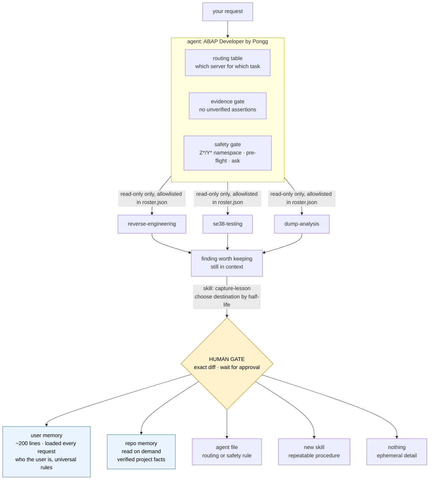

# abap-copilot-kit

A reproducible VS Code Copilot setup for SAP/ABAP work, built on three rules:

1. **Route, don't overlap.** One task, one MCP server. A per-task table, not a global ranking,
   because a priority list gets skipped the moment the top tool lacks the operation.
2. **Never guess.** Every environmental claim needs a tool result from the current session.
   A hypothesis is fine when labelled; a guess stated as fact is not.
3. **The human decides.** AI detects drift and proposes changes. You approve every file edit.

SAP tooling changes constantly — a server updates, an extension ships new tools, an installer
rewrites its agents. This workspace is built to stay correct when that happens, instead of
accumulating instructions that were true once.

## What is here

```
AGENTS.md          workspace contract: connection scope, access rules, session start
INDEX.md           one-screen map of this repository and of where memory really lives
agents/            custom agents with routing, safety and evidence gates
skills/            hand-written skills: mcp-surface-audit, capture-lesson
roster.json        delegation allowlist — read-only subagents only
hooks/             three detection-only hooks (see below)
docs/              architecture, tool routing, ownership, anti-hallucination
config-templates/  mcp.json and settings fragments with placeholders
memory-templates/  user profile template
templates/         project and program README templates
Projects/          convention only — local notebook, gitignored
```

## One fact worth reading before anything else

**SAP connections are user-scoped, not workspace-scoped.** MCP servers live in
`%APPDATA%\Code\User\mcp.json`, ABAP FS destinations in `abapfs.remote` inside the user
`settings.json`, and the ADT MCP server in `adt.mcpServer.*`. Opening a folder selects
nothing: every configured server stays reachable from every folder, and several customers
can be reachable at once.

So a folder named after a project is documentation, not isolation. Confirm the system and
client explicitly before a read or a write. The only real pin would be a workspace-scoped
`.mcp.json` at the folder root, which means duplicating the server config — this repository
does not do that on purpose. `AGENTS.md` carries the same warning for the agent.

## Hooks

All three are detection only. None of them edits an agent, skill, or config file.

They live in **one** file, `~/.copilot/hooks/hooks.json`, in the Copilot CLI format:
`"version": 1`, camelCase event names, one `{"type":"command","command":"…"}` entry per event.
Three separate per-event files do not work — the loader requires a top-level `hooks` object.

A hook that injects context must answer in this shape:

```json
{ "hookSpecificOutput": { "hookEventName": "SessionStart", "additionalContext": "…" } }
```

`hookEventName` must equal the event that fired. A top-level `additionalContext` is ignored,
and a mismatched `hookEventName` is stripped.

| Event | Script | What it does | Context cost |
| --- | --- | --- | --- |
| `sessionStart` | `session-drift.cjs` | snapshots agents, both skill roots, MCP servers, extension tool counts; reports only what changed | `{}` when nothing changed |
| `subagentStart` | `subagent-rules.cjs` | prepends the namespace and evidence rules to a delegated task; restricts any agent not in `roster.json` | once per subagent |
| `postToolUseFailure` | `lesson-capture.cjs` | appends one evidence row per failed tool call | `{}` until the third identical failure |

> **Harness caveat.** VS Code documents `chat.useHooks` and `chat.hookFilesLocations` as
> *Local agent harness only*, while `chat.defaultToCopilotHarness` defaults to `true`. Confirm a
> hook actually fires in your harness before depending on it — `session-drift.cjs` rewrites
> `~/.copilot/state/surface.json` on every run, so its `takenAt` is the proof.

The subagent hook exists because a subagent runs in its own context: the coordinating
agent's rules do not reach it. Without this, delegating a write would bypass the `Z*`/`Y*`
namespace rule and the evidence gate. The default is restrictive, so an agent installed
tomorrow is read-only until a human adds it to the roster.


## Design in one diagram

The shape is deliberate: route, gate, capture, promote. The two memory layers are separate
because they have different half-lives and different costs.



**Both memory layers are outside this repository** and stay there: user memory is loaded from
the VS Code user data folder, repo memory from the per-workspace folder. Copying either into the
repository would create a second copy that nothing loads and nobody updates.

**The capture step is a skill, not a hook, on purpose.** The detection hooks cannot fire in the
Copilot harness, so a loop that depends on them never runs. `capture-lesson` drives the same loop
on purpose, while the finding is still in context.

## Install

**1. Agents.** Copy `agents/*.agent.md` into `~/.copilot/agents/` (`%USERPROFILE%\.copilot\agents`
on Windows). Reload the window, then pick one from the agent dropdown.

**2. Skills.** Copy `skills/mcp-surface-audit` and `skills/capture-lesson` into
`~/.copilot/skills/`. Skills only load in a new chat session, so start a fresh chat after copying.

**3. Roster.** Copy `roster.json` to `~/.copilot/roster.json`. Edit the file names to match the
agents you actually installed. An agent not listed there is not delegatable — that is the point
of an allowlist.

**4. MCP servers.** Copy `config-templates/mcp.json.template` to
`%APPDATA%\Code\User\mcp.json` and replace every `{{PLACEHOLDER}}`. The template is JSONC;
strip the comments if your editor refuses them.

**5. Settings.** Merge the keys in `config-templates/settings.json.template` into your
`settings.json`. Do not paste over your existing file.

**6. Profile (optional).** Copy `memory-templates/user-profile.md` to your Copilot memory folder
and fill it in. Keep it under about 40 lines: user memory is loaded into every session.

**7. Workspace contract (optional).** If you open this repository as a VS Code workspace
folder, `AGENTS.md` is loaded into every request. It costs about 850 tokens at its current
length, and it is the place to put the connection-scope warning where the agent cannot miss it.
Drop the file if you use the repository only as a source of files to copy.

**8. Hooks (optional).** Copy the three `hooks/*.cjs` scripts into `~/.copilot/hooks/`, then copy
`hooks/hooks.json.template` to `~/.copilot/hooks/hooks.json` and replace `{{COPILOT_HOME}}` with
your Copilot folder path. Drop any event you do not want. Verify the scripts parse before
relying on them:

```powershell
Get-ChildItem "$env:USERPROFILE\.copilot\hooks\*.cjs" | ForEach-Object { node --check $_.FullName; "$($_.Name): $LASTEXITCODE" }
```

Hooks are a preview feature. Test one at a time and confirm it fires before adding the next.
For `sessionStart`, firing is provable: `surface.json` gets a new `takenAt` on every run.

## What is deliberately not here

| Excluded | Why |
| --- | --- |
| Installed agents and skills | owned by their packages; reinstall rather than copy |
| `mcp.json` with real values | contains hostnames, users, and CA paths |
| `settings.json` | contains an ADT token |
| `.skill-lock.json` | absolute paths and hashes from one machine |
| Memory contents | may contain system identifiers and business data |
| `Projects/<PROJECT>/…` | customer SID, client and transport numbers |
| Live `hooks/*.json` | machine-specific absolute paths |

**One tracked file does contain system names.** The routing table in
`agents/abap-developer-by-pongg.agent.md` lists which SAP system each MCP server reaches,
because that is the whole point of the table. Nothing there is a credential — no user,
password, token or host name — but it does name systems. Treat the repository as private
unless you sanitize that table first. Making the repository public is not reversible in the
sense that matters: history keeps what was published.

**Clone and expect this:** a fresh clone gives you every file above plus `AGENTS.md`,
`INDEX.md`, `templates/`, and `Projects/README.md` — about 26 files. It does **not** give
you a working SAP connection, memory, or project records. Those are user-scoped and must be
rebuilt per machine, which is why `config-templates/` and `memory-templates/` exist.

Line endings are pinned to LF by `.gitattributes`. Without it, this machine's system
`core.autocrlf=true` produced CRLF in a fresh clone while the mirrored source files were LF,
so one commit had two byte representations on disk.

## Adapting it

The parts worth keeping even if you replace everything else:

- **An allowlist, not a denylist.** An agent installed tomorrow is not delegatable by default,
  without anyone needing to notice it appeared.
- **Ownership by hash.** Compare against the installer's manifest instead of trusting a file
  name.
- **Capture separated from action.** Recording a failure writes one line and never edits a rule.
- **One home per rule.** A duplicated table is a future defect, not redundancy.

## License

MIT. The agent and skill files are yours to adapt. Third-party names (SAP, ABAP, RAP, ARC-1)
belong to their owners; this repository is not affiliated with or endorsed by SAP SE.
