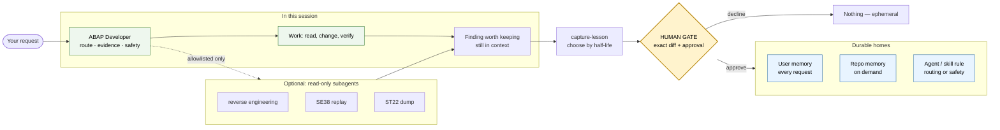

# abap-copilot-kit

A reproducible VS Code Copilot setup for SAP/ABAP work, built around three habits:

1. **One task, one MCP server.** Route by task instead of keeping a global priority list — a
   ranking gets ignored the moment its top pick can't do the job.
2. **Never guess.** If it's about the environment, show the tool result from this session. A
   clearly labelled hypothesis is fine; a guess stated as fact isn't.
3. **You decide.** The agent spots drift and suggests changes. You approve each edit.

SAP tooling moves fast: servers update, extensions add tools, installers rewrite their agents.
This kit is built to stay honest through all of that, rather than piling up instructions that were
true once.

**Windows only:** credentials live in Windows Credential Manager, paths use `%USERPROFILE%`, and
the scripts run on PowerShell 5.1. The agent, skill and hook files themselves are portable; the
tooling is not.

**Contents:** [What is here](#what-is-here) · [Read first](#one-fact-worth-reading-before-anything-else) ·
[Hooks](#hooks) · [Design](#design-in-one-diagram) · [Install](#install) ·
[Not here](#what-is-deliberately-not-here) · [Contract backup](#where-a-programs-contract-is-backed-up) ·
[Releasing](#releasing) · [Adapting](#adapting-it) · [License](#license)

## What is here

```
AGENTS.md          workspace contract: connections, access rules, session start
INDEX.md           one-screen map of the repo and of where memory lives
agents/            custom agents: routing, safety, evidence gates
skills/            the kit's seven hand-written skills
roster.json        delegation allowlist (read-only subagents)
hooks/             three detection-only hooks
docs/              architecture, tool routing, ownership, anti-hallucination
docs/reference/    lookup detail: ARC-1, skills, paths, hooks, output levels
config-templates/  mcp.json, settings.json, arc1.env and connections skeletons
memory-templates/  user profile template
templates/         project / program / spec templates
tooling/           verify-all, census, install-kit, connection + credential scripts,
                   auth probe, context measure, workspace-sync
backup/            recovery snapshot of user memory (nothing loads it)
Projects/          local notebook, gitignored, mirrored to a private repository
```

## One fact worth reading before anything else

**SAP connections belong to the user, not the workspace.** MCP servers live in
`%APPDATA%\Code\User\mcp.json`; ABAP FS and ADT endpoints live in your user `settings.json`.
Opening a folder changes nothing — several systems can be reachable at the same time.

So a folder named after a project is a label, not a fence. Say the system and client out loud
before reading or writing anything. A workspace `.mcp.json` *would* pin them down, but it means
copying the whole server config, so this kit deliberately leaves that alone. `AGENTS.md` says the
same thing to the agent.

## Hooks

All three hooks only watch. None of them touches an agent, skill or config file. They share one
file, `~/.copilot/hooks/hooks.json` (Copilot CLI format: `version: 1`, camelCase event names, one
`{"type":"command","command":"…"}` entry per event). One file per event doesn't work — the loader
wants a single top-level `hooks` object.

| Event | Script | What happens |
| --- | --- | --- |
| `sessionStart` | `session-drift.cjs` | tells you what changed in agents, skills, MCP servers and tool counts |
| `subagentStart` | `subagent-rules.cjs` | prepends namespace/evidence rules; locks out agents missing from `roster.json` |
| `postToolUseFailure` | `lesson-capture.cjs` | writes one evidence row per failed call |

A hook that injects context has to reply as
`{"hookSpecificOutput":{"hookEventName":"<event>","additionalContext":"…"}}` — a top-level
`additionalContext` gets dropped.

> Hooks are still a preview feature, so don't take one on faith. For `sessionStart`, a fresh
> `takenAt` in `~/.copilot/state/surface.json` is your proof that it fired.

The subagent hook exists because a delegated agent runs in its own context: it can't see the main
agent's rules. Until a human adds a new agent to the roster, it stays read-only.


## Design in one diagram

Route → gate → capture → promote:



Both memory layers live **outside** this repository: user memory in the VS Code user data folder,
repo memory in each workspace. Copying them in here would just give you a second version that
nothing reads.

Capture is a **skill** rather than a hook on purpose: `postToolUseFailure` has never once produced
a ledger in this harness, so the loop runs while the finding is still fresh in context.

## Install

Let the scripts handle the mechanical part. What's left needs your judgement or a real value.

### Install and check

```powershell
powershell -File tooling\install-kit.ps1 -Check     # preview only
powershell -File tooling\install-kit.ps1           # copy what is missing
powershell -File tooling\verify-all.ps1            # is anything wrong?
powershell -File tooling\census.ps1                # what's here, and what no gate reads?
```

`install-kit.ps1` copies agents, tooling and this kit's seven skills. It's safe to re-run, and it
won't overwrite a live file that differs — use `-Force` once you're sure the clone is the newer
one. It finds the kit root via `$env:ABAP_KIT_ROOT`, then a `kit-root.txt` pin from an earlier run,
then simply the parent of `tooling\`.

Both checks only read things, and both exit non-zero when something's off. `verify-all` prints
`SKIP` with a reason rather than pretending to pass. `census` lists every artifact the kit owns
or leans on, and names files nothing accounts for — worth running because earlier rounds looked
clean while six backup files outside the repository quietly held internal hostnames, out of reach
of any `git ls-files` check. Add `-Detail full` to either script for the full list.

### Steps

**1–3. Agents, skills, roster.** Move `agents/*.agent.md` into `~/.copilot/agents/`,
`skills/*/` into `~/.copilot/skills/`, and `roster.json` into `~/.copilot/roster.json`. Skills
only load in a fresh chat, so open one after copying. If an agent isn't on the roster, it's not
delegatable — that's the point. `install-kit.ps1` does all three for you, and it walks the folder,
so a skill added later needs no change here.

**4. MCP servers.** Copy `config-templates/mcp.json.template` to `%APPDATA%\Code\User\mcp.json`
and fill in every `{{PLACEHOLDER}}`. It's JSONC, so drop the comments if your editor complains.

**5. Credentials — one password, both clients.** Keep the password out of the config file: the
Copilot CLI has no Quick Input, and on Windows its config folder is readable by another group.
So you name a connection rather than type credentials into JSON:

```powershell
tooling\sap-connection.ps1 -Add -Name dev-110 -Url https://host:44381 -Client 110 -User <sap user>
powershell -ExecutionPolicy Bypass -File tooling\sap-secret.ps1 -Set -Key dev-110_SAP_PASSWORD
```

`-Set` asks once, then stores it in Windows Credential Manager. Point both harnesses at the
launcher from `config-templates/mcp-config.template.json` (`mcpServers` for the CLI, `servers`
for VS Code) and neither config ever sees the password. Leave the policy switches
(`SAP_ALLOW_WRITES`, `SAP_ALLOWED_PACKAGES`, …) in `env`, and don't set `SAP_URL` or `SAP_USER`
twice — the audit watches both files for exactly that.

When a script spawns a process, give the interpreter its **full path**. A bare `powershell`
fails with `ENOENT` under a trimmed `PATH`, and all you'll notice is that the server's tools
never show up. The scripts themselves use `$PSHOME` for this reason. (Typing `powershell` in
your own shell is fine.)

On startup `sap-auth-probe.js` (run through `node`) asks SAP whether the stored password still
works. `OK` starts normally. `STALE` opens the native Windows prompt, saves the new value and
tries once more. `UNKNOWN` — network, TLS, server down — says so once and starts anyway,
because a broken network isn't a bad password. The prompt gives up after `-PromptTimeoutSec`
(default 180 seconds).

**6–7. Settings and profile (optional).** Fold `config-templates/settings.json.template` into
your own `settings.json` — merge, don't overwrite. You can also copy
`memory-templates/user-profile.md` into your Copilot memory folder; keep it short, because user
memory loads on every single request.

**8. Workspace contract (optional).** If you open this repository as a workspace folder,
`AGENTS.md` rides along into every request. Just delete it if all you want is the files.

**9. Hooks (optional).** Copy `hooks/*.cjs` into `~/.copilot/hooks/`, then rename
`hooks/hooks.json.template` to `hooks.json` and replace `{{COPILOT_HOME}}`. Run
`node --check <file>` on each script, and turn events on one at a time so you know which one
actually fires.

### Skills without cloning

If you have access to the private repo, the CLI can install just the skills:

```powershell
npx skills add naruepan2/abap-copilot-kit -s capture-lesson -g
```

Agents, tooling and templates still come from the clone.

## What is deliberately not here

| Excluded | Why |
| --- | --- |
| Installed agents and skills | owned by their packages; reinstall rather than copy |
| `mcp.json` with real values | contains hostnames, users, and CA paths |
| `settings.json` | contains an ADT token |
| `.skill-lock.json` | absolute paths and hashes from one machine |
| Memory contents | may contain system identifiers and business data |
| `Projects/<PROJECT>/…` | customer SID, client and transport numbers |
| `Projects/_routing.local.md` | which server reaches which system, and which client is authorized |
| Live `hooks/*.json` | machine-specific absolute paths |

**No tracked file names a customer, host or user.** The agent's routing table only says what
each server is *allowed* to do; the machine-specific mapping lives in gitignored
`Projects/_routing.local.md`, which the agent reads before its first SAP call. The audit pulls
sensitive patterns from your gitignored connection store at run time and checks history as well
as the working tree — a scan that only looks at the working tree once missed this kind of leak
for sixteen commits. Anything one-off goes in `tooling/verify-patterns.local.txt` (gitignored,
one value per line).

The rule is simple: **if a value could identify a customer, system, person or session, it goes in
a gitignored file — and the tracked file just says where to look.**

A fresh clone gives you everything above plus `AGENTS.md`, `INDEX.md`, `templates/` and
`Projects/README.md`. It won't give you a working SAP connection, memory, or project records —
those are per-machine. If you want the exact file list, ask `git ls-files`; numbers written in
prose have a habit of going stale.

## Where a program's contract is backed up

`Projects\<PROJECT>\<PROGRAM>` is gitignored because it holds customer identifiers — which also
means the contract had no history and no copy off the machine. `tooling/workspace-sync.ps1` fixes
that by mirroring it into a second private repository, using an **allowlist**:

| Mirrored | Never mirrored |
| --- | --- |
| `README.md`, `project.yaml`, `program.yaml`, `changes.md` | `spec\source\**` — the functional's document |
| `spec\INDEX.md`, `spec\notes.md`, `spec\spec.md`, `spec\CHANGELOG.md` | `.baseline\**` — captured customer source |
| `manifest.json` (sha256, bytes, lines) | anything else |

An allowlist means a file type nobody has named yet simply isn't mirrored — so nothing leaks by
default. The spec itself stays out, but its integrity is still watched: `program.yaml` records
`spec_lines` and `spec_bytes`, and `-Check` raises a flag when a new version shows up.

```powershell
tooling\workspace-sync.ps1 -Workspace <clone>            # preview
tooling\workspace-sync.ps1 -Workspace <clone> -Check     # drift, exit 1 if any
tooling\workspace-sync.ps1 -Workspace <clone> -Write     # copy and refresh manifest
```

Use `-RepoMemory <path>` to include per-workspace memory too, **recursively**. It's a backup,
not a move — VS Code keeps reading the live folder. Passwords and tokens are refused outright;
customer names are expected there. Hashes fold CRLF→LF and strip any BOM, and the mirror pins
`eol=lf`, so your editor's line endings never look like real changes.

## Releasing

There's no `CHANGELOG.md`, and that's deliberate: `git log` already is the changelog. Instead,
an annotated tag carries the release notes, which you write straight out of the commits since the
last tag:

```powershell
git log --oneline v0.9.4.9..HEAD    # changes since the last tag
git tag -a v0.10.0 -F notes.txt
git push origin v0.10.0
```

Keep in mind the tag message is **not** the GitHub release body — paste the same notes into the
release form as well. `~/.copilot/backups/release-notes-<tag>.md` stays the copy of record, while
the tag is the immutable pointer. A few older tags only ever got a one-line subject, so audit
section 9d checks every tag against its notes file and calls out mismatches. Once a tag is out,
never rewrite it — fix forward instead.

## Adapting it

If you keep anything from this kit, keep these ideas:

- **An allowlist, not a denylist.** An agent installed tomorrow can't be delegated to until a
  human says so — nobody has to notice it arrived.
- **Ownership by hash.** Check against the installer's manifest; file names can lie.
- **Capture stays separate from action.** Logging a failure writes one line and never rewrites a
  rule on its own.
- **One home per rule.** A duplicated table isn't backup — it's a defect waiting to drift.

## License

MIT. The agent and skill files are yours to adapt. Third-party names (SAP, ABAP, RAP, ARC-1)
belong to their owners; this repository is not affiliated with or endorsed by SAP SE.
