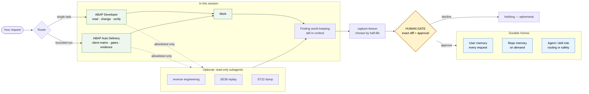

# abap-copilot-kit

A reproducible VS Code Copilot setup for SAP/ABAP work. Three habits make it work:

1. **Route by task.** Choose the server by what the task needs; a fixed global priority stops
   being true the moment its top pick cannot do the job.
2. **Never guess.** Environment claims need a tool result or file read from this session. A labelled
   hypothesis is fine; a guess stated as fact is not.
3. **You decide.** The agent detects drift and proposes changes. A human approves edits and every
   durable rule.

SAP tooling changes quickly — servers update, extensions add tools, installers rewrite agents.
This kit stays honest by checking the live surface instead of accumulating instructions that were
true once.

**Windows only:** credentials live in Windows Credential Manager, paths use `%USERPROFILE%`, and
the scripts run on PowerShell 5.1. Agent, skill and hook files are portable; the tooling is not.

**Contents:** [What is here](#what-is-here) · [Read first](#one-fact-worth-reading-before-anything-else) ·
[Two work modes](#two-work-modes) · [Hooks](#hooks) · [Design](#design-in-one-diagram) ·
[Install](#install) · [Not here](#what-is-deliberately-not-here) · [Backup](#backup-and-restore) ·
[Contract backup](#where-a-programs-contract-is-backed-up) · [Releasing](#releasing) ·
[Adapting](#adapting-it) · [License](#license)

## What is here

```
AGENTS.md          workspace contract: connections, access rules, session start
INDEX.md           one-screen map of the repo and of where memory lives
agents/            shipped developer agent and read-only specialists
skills/            hand-written skills for routing, records, evidence and delivery
docs/              architecture, tool routing, ownership, anti-hallucination
docs/              memory model and decisions, plus architecture and ownership
docs/reference/    lookup detail: ARC-1, skills, paths, hooks, improvement register
config-templates/  mcp.json, settings.json, arc1.env and connections skeletons
memory-templates/  user profile template
templates/         project / program / spec / notes / plan templates
tooling/           verify-all, census, install-kit, connection + credential scripts,
                   auth probe, context measure, workspace-sync, write gate
roster.json        delegation allowlist (read-only subagents)
hooks/             shared watch-only hooks; the enforcement hook is inline in the agent
backup/            snapshot of self-authored agents and skills (nothing loads it)
Projects/          local notebook, gitignored, mirrored to a private repository
```

## One fact worth reading before anything else

**SAP connections belong to the user, not the workspace.** MCP servers live in the active VS Code
profile's `mcp.json`; ABAP FS and ADT endpoints live in the user `settings.json`. Opening a folder
changes nothing — several systems can be reachable at the same time.

Profiles matter: the default profile's `mcp.json` is not inherited by a profile that has none of its
own. If a server disappears from the picker, check the active profile's MCP configuration, then
reload the window and start a new chat before declaring it broken.

A folder named after a project is a label, not a fence. Say the system and client out loud before
reading or writing anything. A workspace `.mcp.json` would pin them down, but that means copying
the whole server config, so this kit deliberately leaves it alone. `AGENTS.md` tells the agent the
same thing.

## Two work modes

- **`ABAP Developer by Pongg`** — single tasks and short changes. It routes by task, checks the
  live tool surface, and keeps the write gate at the commit window. Send it one clear objective.
- **`ABAP Auto Delivery by Pongg`** — a bounded multi-object run after the requirement is clear.
  It adds run state, a client matrix, methodology and design gates, an Object Responsibility Plan,
  per-object evidence and a stop at `READY_FOR_UAT`. It never releases or imports transports and
  performs no production action. It is installed in the user profile and backed up here; it is not
  shipped in `agents/`.

Both use the same routing and evidence habits. Only the scope and gates differ. Neither pins a
`tools:` list: the session supplies whatever MCP and extension tools are currently available,
including public SAP documentation when present. Tool names are observed at runtime, never assumed
from a config file or memory.

## Hooks

The shared hooks in `hooks/` only watch. They use `~/.copilot/hooks/hooks.json` (Copilot CLI
format: `version: 1`, camelCase event names, one command entry per event); one file per event is not
supported because the loader wants a single top-level `hooks` object.

| Event | Script | What happens |
| --- | --- | --- |
| `sessionStart` | `session-drift.cjs` | reports changes in agents, skills, MCP servers and tool counts |
| `subagentStart` | `subagent-rules.cjs` | prepends namespace and evidence rules; blocks agents absent from `roster.json` |
| `postToolUseFailure` | `lesson-capture.cjs` | writes one evidence row per failed call |

A hook that injects context must reply as
`{"hookSpecificOutput":{"hookEventName":"<event>","additionalContext":"…"}}`; a top-level
`additionalContext` is dropped. For `sessionStart`, a fresh `takenAt` in
`~/.copilot/state/surface.json` proves it fired.

The delivery agent also declares an inline `PreToolUse` hook pointing at
`<kit>\tooling\aad_write_gate.py`. Instructions guide; this hook enforces. It denies transport
release, import, delete, service publication, production writes and write targets outside
`Z*`/`Y*`/`$TMP`/`TEST_DEMO*`. It is deliberately narrow and fails open on an unreadable payload;
it is not a full permission boundary, so the agent body still governs every write. A denial stops
that call — reconcile and replan, never rephrase to slip past it.

## Design in one diagram

Route → gate → capture → promote:



Both memory layers live outside this repository: user memory in the VS Code user data folder,
repo memory in each workspace. Copying them here would create a second version nothing reads.
The design is documented once in [`docs/memory-model.md`](docs/memory-model.md) with its
adopt/reject/defer decisions in [`docs/memory-decisions.md`](docs/memory-decisions.md);
external ideas and their status are in
[`docs/reference/improvement-register.md`](docs/reference/improvement-register.md).

Capture is a skill rather than a hook on purpose: the failure hook has not produced a ledger in
this harness, so the loop runs while the finding is still fresh in context.

## Install

Let the scripts do the copying. What remains needs a decision or a real value.

```powershell
powershell -File tooling\install-kit.ps1 -Check     # preview only
powershell -File tooling\install-kit.ps1           # copy what is missing
powershell -File tooling\verify-all.ps1            # is anything wrong?
powershell -File tooling\census.ps1                # what exists, and what no gate reads?
```

`install-kit.ps1` copies shipped agents, tooling and hand-written skills. Re-running is safe; it
will not overwrite a live file that differs unless you pass `-Force`. It locates the kit through
`$env:ABAP_KIT_ROOT`, then a saved `kit-root.txt`, then the parent of `tooling\`.

Both checks only read and exit non-zero on a problem. `verify-all` prints `SKIP` with a reason
instead of pretending to pass. `census` names artifacts nothing accounts for — earlier rounds
looked clean while backup files outside the repository held internal hostnames, beyond the reach
of `git ls-files`. Add `-Detail full` to either script for the full list.

### Steps

1. **Agents, skills, roster.** `install-kit.ps1` copies `agents/*.agent.md` to
   `~/.copilot/agents/`, `skills/*/` to `~/.copilot/skills/`, and `roster.json` to
   `~/.copilot/roster.json`. It walks folders, so a skill added later needs no list edit. Skills
   load only in a fresh chat. An agent absent from the roster is not delegatable.
2. **MCP servers.** Copy `config-templates/mcp.json.template` to the active profile's `mcp.json`
   and fill every `{{PLACEHOLDER}}`. It is JSONC; remove comments if your editor objects.
3. **Credentials.** Name a connection instead of putting a password in JSON; the CLI has no Quick
   Input and its Windows config folder is readable by another group.

   ```powershell
   tooling\sap-connection.ps1 -Add -Name example-100 -Url https://example.invalid:44300 -Client 100 -User <sap user>
   powershell -ExecutionPolicy Bypass -File tooling\sap-secret.ps1 -Set -Key example-100_SAP_PASSWORD
   ```

   `-Set` stores the value in Windows Credential Manager. Point both harnesses at the launcher
   from `config-templates/mcp-config.template.json` (`mcpServers` for the CLI, `servers` for VS
   Code). Leave policy switches such as `SAP_ALLOW_WRITES` and `SAP_ALLOWED_PACKAGES` in `env`, and
   never set `SAP_URL` or `SAP_USER` twice — the audit checks both files for that.

   When a script spawns a process, use the interpreter's full path; a bare `powershell` can fail
   with `ENOENT` under a trimmed `PATH`, and the only symptom is that server tools never appear.
   The scripts themselves use `$PSHOME`.

   At startup `sap-auth-probe.js` asks SAP whether the stored password still works. `OK` starts
   normally; `STALE` opens the Windows prompt, saves the new value and retries; `UNKNOWN`
   (network, TLS, server down) reports once and starts, because a broken network is not a bad
   password. The prompt times out after `-PromptTimeoutSec` (default 180 seconds).

4. **Settings and profile (optional).** Merge `config-templates/settings.json.template` into your
   own `settings.json`; do not overwrite. Keep `memory-templates/user-profile.md` short — user
   memory loads on every request.
5. **Workspace contract (optional).** Opening this repository as a workspace brings `AGENTS.md`
   into every request; delete it if you only want the files.
6. **Hooks (optional).** Copy `hooks/*.cjs` into `~/.copilot/hooks/`, rename
   `hooks/hooks.json.template` to `hooks.json` and replace `{{COPILOT_HOME}}`. Run
   `node --check <file>` on each script and enable events one at a time.

### Skills without cloning

```powershell
npx skills add naruepan2/abap-copilot-kit -s capture-lesson -g
```

Agents, tooling and templates still come from the clone.

## What is deliberately not here

| Excluded | Why |
| --- | --- |
| Installed agents and skills | owned by their packages; reinstall rather than copy |
| `mcp.json` with real values | contains hostnames, users and CA paths |
| `settings.json` | contains an ADT token |
| `.skill-lock.json` | absolute paths and hashes from one machine |
| Memory contents | may contain system identifiers and business data |
| `Projects/<PROJECT>/…` | customer SID, client and transport numbers |
| `Projects/_routing.local.md` | which server reaches which system and client |
| Live `hooks/*.json` | machine-specific absolute paths |

**No tracked file names a customer, host or user.** Routing tables state only what a server may
do; the machine-specific mapping lives in gitignored `Projects/_routing.local.md`, which the agent
reads before its first SAP call. The audit pulls sensitive patterns from the gitignored connection
store at run time and checks history as well as the working tree — a working-tree-only scan once
missed this kind of leak for many commits. One-off values belong in
`tooling/verify-patterns.local.txt` (gitignored, one value per line).

**If a value could identify a customer, system, person or session, it goes in a gitignored file;
the tracked file only says where to look.**

A fresh clone provides the tracked files, not a working SAP connection, memory or project records.
Use `git ls-files` for the exact list; counts written in prose go stale.

## Backup and restore

`backup/self-authored/MANIFEST.md` is the allowlist for a byte-for-byte snapshot of self-authored
agents and skills. It excludes credentials, MCP config, connection details, customer projects and
third-party installer content. Live files remain authoritative.

The `kit-backup` skill is user-invoked and offers `verify` (read-only hash comparison),
`snapshot` (refresh after showing the file list) and `restore` (per-file diff and approval). It
never changes SAP state or configuration, and never overwrites a live file during verification.

## Where a program's contract is backed up

`Projects\<PROJECT>\<PROGRAM>` is gitignored because it holds customer identifiers, so its
contract had no history or off-machine copy. `tooling/workspace-sync.ps1` mirrors it into a second
private repository using an **allowlist**:

| Mirrored | Never mirrored |
| --- | --- |
| `README.md`, `project.yaml`, `program.yaml`, `changes.md` | `spec\source\**` — the functional document |
| `spec\INDEX.md`, `spec\notes.md`, `spec\spec.md`, `spec\CHANGELOG.md` | `.baseline\**` — captured customer source |
| `manifest.json` (sha256, bytes, lines) | anything else |

An allowlist means a file type nobody has named yet is not mirrored, so nothing leaks by default.
The functional document stays out; its integrity is still watched through `spec_lines` and
`spec_bytes` in `program.yaml`, and `-Check` reports a changed version.

```powershell
tooling\workspace-sync.ps1 -Workspace <clone>            # preview
tooling\workspace-sync.ps1 -Workspace <clone> -Check     # drift, exit 1 if any
tooling\workspace-sync.ps1 -Workspace <clone> -Write     # copy and refresh manifest
```

`-RepoMemory <path>` also includes per-workspace memory recursively. This is a backup, not a move:
VS Code keeps reading the live folder. Passwords and tokens are refused; customer names are
expected. Hashes fold CRLF→LF and strip BOM, and the mirror pins `eol=lf`, so editor line endings
do not look like real changes.

## Releasing

`CHANGELOG.md` is an index: one row per tag with date, short theme and peeled commit. Full notes
live in the tag annotation and the GitHub release body, not in the index — a second copy would
drift. Write notes from the commits since the last tag:

```powershell
$last = git describe --tags --abbrev=0
git log --oneline "$last..HEAD"
git tag -a vNEXT -F notes.txt
git push origin vNEXT
```

Add the matching `CHANGELOG.md` row in the same change. The tag message is not the GitHub release
body; paste the notes into the release form too. `~/.copilot/backups/release-notes-<tag>.md` is the
copy of record and the tag is the immutable pointer. Audit 9d compares tag and notes; 9f checks
that every tag has a row and every row names a real tag. Never rewrite a released tag — fix
forward.

## Adapting it

Keep these ideas if you keep nothing else:

- **Allowlist, not denylist.** A newly installed agent becomes delegatable only after a human says
  so.
- **Ownership by hash.** Compare with the installer manifest; file names can lie.
- **Capture stays separate from action.** A logged failure never rewrites a rule by itself.
- **One home per rule.** A duplicated table is not backup — it is a drift waiting to happen.
- **Enforce at the right layer.** Prompts guide; hooks and validators decide what can pass.

## License

MIT. Adapt the agent and skill files freely. Third-party names (SAP, ABAP, RAP, ARC-1) belong to
their owners; this repository is not affiliated with or endorsed by SAP SE.
