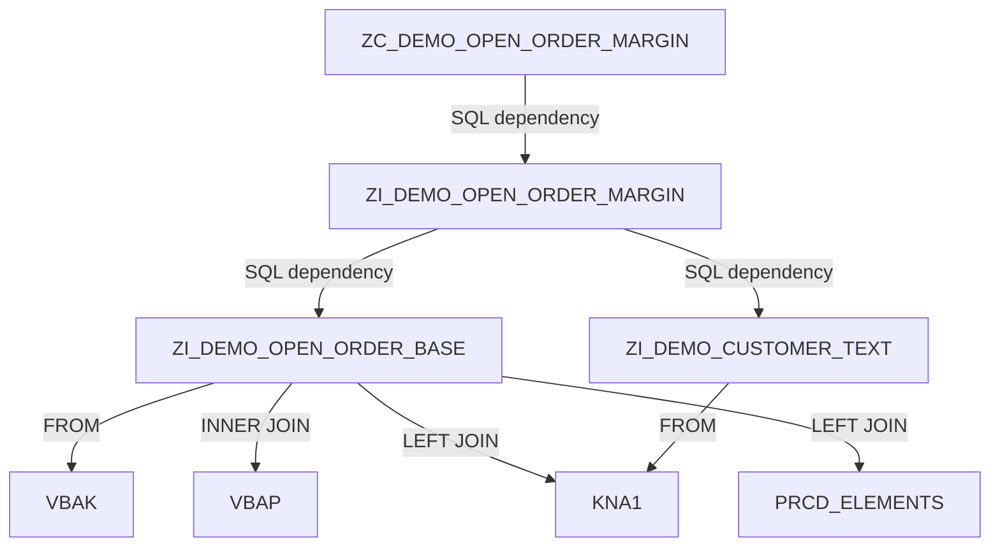

# Technical Specification: ZC_DEMO_OPEN_ORDER_MARGIN

> **Evidence status:** ส่วนใหญ่ `OBSERVED` · F-02 เป็น `INTERPRETATION` · DCL เป็น `UNRESOLVED` (mock)
> **Architecture classes:** `CDS_SQL_GRAPH`, `RAP_SERVICE_UNVERIFIED`
> **Overall confidence:** `Medium` — ไม่มี runtime evidence และ DCL ยังยืนยันไม่ได้

> **SAMPLE / MOCK DATA — ไม่ใช่ผลการวิเคราะห์จริง**
> ทุก object, field, count, evidence ID และ finding เป็นข้อมูลสมมติ ใช้ดูโครงสร้างและการจัดหน้าเท่านั้น
> HTML rendition: `technical-specification-sample.html` — derive จากไฟล์นี้

## 1. Document Control

| รายการ | ค่า |
|---|---|
| Source system / client | `DEMO_S4H` · client `100` (mock) |
| Extraction date | 2026-11-24 (mock) |
| Requested scope | root + CDS dependency branches |
| Intensity profile | `COMPREHENSIVE` |
| Verified root type | `DDLS` (CDS consumption view) |
| Dominant archetype | `CDS_SQL_GRAPH` |
| Additional architecture classes | `RAP_SERVICE_UNVERIFIED` |
| Template | `templates/technical-specification.md` (canonical default) |
| Output language | `TH` (Thai prose + bilingual headings) |
| Output format | `MARKDOWN` (source) → `HTML` (derived rendition) |
| Document version | 0.2 (sample) |
| Status | `SAMPLE_ONLY` |
| Limitations | ข้อมูลทั้งหมดเป็น mock; ไม่มีการอ่าน SAP จริง |

## 2. Technical Overview

รายงานนี้แสดงยอดขายเทียบต้นทุนและอัตรากำไรขั้นต้นของใบสั่งขายที่ยังเปิดอยู่ ผู้ใช้กรองตามองค์กรและช่วงวันที่ส่งมอบ และระบบรวมยอดต่อรายการสินค้าเพื่อให้เห็นใบสั่งที่กำไรต่ำกว่าที่คาด

กลไกคือ CDS stack สี่ชั้นที่อ่านตารางขายมาตรฐานแล้วเสริมชื่อลูกค้าและต้นทุนจากเงื่อนไขราคา (`ZC_DEMO_OPEN_ORDER_MARGIN` → `ZI_DEMO_OPEN_ORDER_MARGIN` → `ZI_DEMO_OPEN_ORDER_BASE` → physical tables)

จุดที่ผู้อ่านควรระวัง: การหารอัตรากำไรไม่มี guard เมื่อยอดเป็นศูนย์ และต้นทุนจะนับก็ต่อเมื่อมี `KSCHL = 'VPRS'` ถ้าไม่พบ ระบบรายงานกำไรเท่ากับยอดขาย ซึ่งดูเหมือนกำไรดีทั้งที่ข้อมูลต้นทุนขาด

## 3. Repository Object Identification

| Object | Type | Package | Version | Read | Status |
|---|---|---|---|---|---|
| `ZC_DEMO_OPEN_ORDER_MARGIN` | `DDLS` | `ZDEMO_SD_MARGIN` | 2026-11-10 (mock) | full | `Detected` |
| `ZI_DEMO_OPEN_ORDER_MARGIN` | `DDLS` | `ZDEMO_SD_MARGIN` | 2026-11-08 (mock) | full | `Detected` |
| `ZI_DEMO_OPEN_ORDER_BASE` | `DDLS` | `ZDEMO_SD_MARGIN` | 2026-10-30 (mock) | full | `Detected` |
| `ZI_DEMO_CUSTOMER_TEXT` | `DDLS` | `ZDEMO_SD_MARGIN` | 2026-09-14 (mock) | full | `Detected` |
| DCL role ของ root | `DCLS` | — | — | not found | `Expected but Missing` |
| Service binding | `SRVB` | — | — | unverified | `Unverified` |

### 3.1 Solution Boundary

| หมวด | รายการ | เหตุผล / ผล |
|---|---|---|
| Included | CDS stack 4 ชั้น + ตารางฐาน | scope ที่ตรวจแล้ว |
| Excluded / inaccessible | ข้อมูล row จริงของ `VBAK`, `VBAP` | ต้องได้รับอนุญาตอ่านข้อมูลก่อน |
| Expected but missing | DCL role ของ `ZC_DEMO_OPEN_ORDER_MARGIN` | ค้น metadata แล้วไม่พบ ผล: authorization ยัง `UNRESOLVED` |

## 4. Technical Architecture

### 4.1 Architecture / Dependency Layers

| Layer | Object | บทบาท |
|---|---|---|
| Consumption | `ZC_DEMO_OPEN_ORDER_MARGIN` | projection สำหรับผู้ใช้ |
| Interface | `ZI_DEMO_OPEN_ORDER_MARGIN` | คำนวณกำไร |
| Base join | `ZI_DEMO_OPEN_ORDER_BASE` | รวมหัว/รายการขายกับลูกค้า |
| Text | `ZI_DEMO_CUSTOMER_TEXT` | ชื่อลูกค้าตามภาษา |
| Physical | `VBAK`, `VBAP`, `KNA1`, `PRCD_ELEMENTS` | ตารางฐาน |

### 4.2 Dependency / Execution Graphs

Mermaid เป็นภาพสรุป; Appendix A/C คือบันทึกที่ตรวจสอบได้ ภาพไม่ใช่หลักฐาน

## 5. Inputs, Parameters and Selection Behavior

| พารามิเตอร์ | ที่มา | ผล |
|---|---|---|
| `p_CompanyCode` | view parameter (mock) | จำกัดตามบริษัท |
| `p_DeliveryDateFrom` / `p_DeliveryDateTo` | view parameter (mock) | กรองช่วงส่งมอบ |

## 6. Processing and Dependency Design

### 6.1 UNION and Set-Operation Branches

ไม่พบ set operation ใน scope นี้ — ไม่เติมตารางว่าง

### 6.2 JOIN Matrix

| ซ้าย | ขวา | ชนิด | เงื่อนไข | ผลเมื่อไม่พบคู่ |
|---|---|---|---|---|
| `VBAK` | `VBAP` | `INNER JOIN` | `VBELN` | ใบสั่งที่ไม่มีรายการหาย |
| `VBAP` | `KNA1` | `LEFT JOIN` | `KUNNR` | ชื่อลูกค้าว่าง |
| `VBAP` | `PRCD_ELEMENTS` | `LEFT JOIN` | `VBELN/POSNR` + `VPRS` | ต้นทุนเป็นศูนย์ |

### 6.3 Filters and Row-Exclusion Rules

- กรองใบสั่งตามช่วงวันที่ที่กำหนด (mock)
- ตัดรายการที่ `WAERK` ว่าง (mock)

### 6.4 Aggregation, Currency, Sign and Date Logic

- รวมยอดต่อ `VBELN` + `POSNR`
- `MarginAmount = NetAmount - CostAmount`
- `MarginPercent = ( MarginAmount / NetAmount ) * 100` — ไม่มี guard สำหรับ `NetAmount = 0`
- ใช้ `WAERK` จากหัวใบสั่ง ไม่มีการแปลงสกุลเงินในชั้นนี้

## 7. Output Shape / Exposed Fields

หลักฐาน `DECLARED` จาก element ของ root (mock)

| # | Field | ชนิด | หลักฐาน |
|---|---|---|---|
| 1 | `SalesDocument` | `VBELN` | `EV-001` |
| 2 | `SalesDocumentItem` | `POSNR` | `EV-001` |
| 3 | `SoldToParty` | `KUNNR` | `EV-001` |
| 4 | `CustomerName` | `NAME1` | `EV-002` |
| 5 | `NetAmount` | `CURR` | `EV-001` |
| 6 | `CostAmount` | `CURR` | `EV-003` |
| 7 | `MarginAmount` | `CURR` | `EV-001` |
| 8 | `MarginPercent` | `DEC` | `EV-001` |
| 9 | `Currency` | `WAERK` | `EV-001` |
| 10 | `DeliveryDate` | `VDATU` | `EV-001` |

ไม่มีการยืนยัน `UI_CONFIGURED` หรือ `RUNTIME_OBSERVED` — ยังไม่มี UI annotation evidence และไม่ได้รันระบบ

## 8. Field-Level Lineage

| Field | ที่มา | การแปลง | หลักฐาน |
|---|---|---|---|
| `MarginAmount` | `NetAmount`, `CostAmount` | ผลต่าง | `EV-001` L42–L44 (mock) |
| `MarginPercent` | `MarginAmount`, `NetAmount` | หาร×100 ไม่มี guard | `EV-001` L45–L47 (mock) |
| `CostAmount` | `PRCD_ELEMENTS~KWERT` | เฉพาะ `VPRS` | `EV-003` L18–L24 (mock) |
| `CustomerName` | `KNA1~NAME1` | ผ่าน text view | `EV-002` L12–L16 (mock) |

## 9. Table Functions and AMDP

ไม่มีใน scope นี้

## 10. Authorization Design

| ประเด็น | สถานะ | หลักฐาน |
|---|---|---|
| DCL ของ `ZC_DEMO_OPEN_ORDER_MARGIN` | `PROVIDER_LIMITED` / `Expected but Missing` | `EV-004` |
| การกรองระดับบริษัท | พบ parameter ไม่พบ authority check | `EV-001` |

ห้ามสรุปว่าปลอดภัยหรือไม่ปลอดภัยจากหลักฐานที่มี

## 11. RAP and Service Exposure

ไม่พบ service definition หรือ binding ใน scope → `Unverified` ไม่ใช่ "ไม่มี"

## 12. Configuration Dependencies

| Object | บทบาท | หลักฐาน |
|---|---|---|
| `PRCD_ELEMENTS` (`VPRS`) | แหล่งต้นทุนขาย | `EV-003` |

## 13. Change and Transport History

| Object | Revision | Transport |
|---|---|---|
| `ZC_DEMO_OPEN_ORDER_MARGIN` | 3 (mock) | `DEMOK900123` (mock) |

## 14. SAP-Native Complexity Metrics

`NOT_COLLECTED` — ไม่มี metric จากผู้ให้บริการ

## 15. Dependency Reconciliation and Coverage

`NOT_APPLICABLE` — ไม่มี dependency artifact ส่งมา

## 16. Static Findings and Risks

| ID | ระดับ | ข้อความ | สถานะ |
|---|---|---|---|
| F-01 | สูง | หารด้วยยอดเป็นศูนย์ | `OBSERVED` (`EV-001`) |
| F-02 | สูง | ต้นทุนขาดเมื่อไม่มี `VPRS` → กำไรดูสูงเกินจริง | `INTERPRETATION` (`EV-003`) |
| F-03 | กลาง | ไม่พบ authorization check ในชั้น view | `OBSERVED` (`EV-001`), DCL `UNRESOLVED` |
| F-04 | ต่ำ | `LEFT JOIN` ทำให้ชื่อลูกค้าว่างได้ | `OBSERVED` (`EV-001`) |

## 17. Test and Runtime Handoff

| รายการ | สถานะ |
|---|---|
| Static analysis | done (mock) |
| ABAP Unit | ไม่ได้รัน |
| Runtime / data verification | ไม่ได้รัน — ต้องได้รับอนุญาตอ่านข้อมูล |
| ต้องทดสอบ | `NetAmount = 0`, ไม่มี `VPRS`, ไม่มี `KNA1`, หลายสกุลเงิน |

## 18. Final Acceptance and Cleanup

| มิติ | ผล |
|---|---|
| Structural completion | `REQUESTED_SCOPE_COMPLETE_WITH_STANDARD_BOUNDARIES` (mock) |
| Semantic / lineage | `SEMANTIC_PARTIAL` |
| Evidence locatability | `PARTIAL` — F-02 เป็น interpretation |
| Language check | `MANUAL` (mock) |
| Rendition parity | `MATCHED` |
| Scratchpad | `NOT_USED` |
| Final outcome | `ACCEPTED_WITH_LIMITATIONS` (sample) |

ส่วนนี้เป็น status declaration สั้น ๆ รายละเอียด check อยู่ใน `evidence-model.json` และ `VALIDATION_REPORT.md` เมื่อผู้ใช้ขอ

# Appendices

## Appendix A. Canonical Object Registry

| ID | Object | Type | Package | Read |
|---|---|---|---|---|
| OBJ-01 | `ZC_DEMO_OPEN_ORDER_MARGIN` | `DDLS` | `ZDEMO_SD_MARGIN` | full |
| OBJ-02 | `ZI_DEMO_OPEN_ORDER_MARGIN` | `DDLS` | `ZDEMO_SD_MARGIN` | full |
| OBJ-03 | `ZI_DEMO_OPEN_ORDER_BASE` | `DDLS` | `ZDEMO_SD_MARGIN` | full |
| OBJ-04 | `ZI_DEMO_CUSTOMER_TEXT` | `DDLS` | `ZDEMO_SD_MARGIN` | full |
| OBJ-05 | `VBAK` | `TABL` | standard | metadata |
| OBJ-06 | `VBAP` | `TABL` | standard | metadata |
| OBJ-07 | `KNA1` | `TABL` | standard | metadata |
| OBJ-08 | `PRCD_ELEMENTS` | `TABL` | standard | metadata |

## Appendix C. Parent-to-Leaf Path Registry

| Path | เส้นทาง |
|---|---|
| P-1 | `ZC_DEMO_OPEN_ORDER_MARGIN` → `ZI_DEMO_OPEN_ORDER_MARGIN` → `ZI_DEMO_OPEN_ORDER_BASE` → `VBAK` / `VBAP` |
| P-2 | `ZI_DEMO_OPEN_ORDER_MARGIN` → `ZI_DEMO_CUSTOMER_TEXT` → `KNA1` |

## Appendix D. Evidence Pointer Register

| ID | Object | Location | หมายเหตุ |
|---|---|---|---|
| EV-001 | `ZI_DEMO_OPEN_ORDER_MARGIN` | source L1–L60 (mock) | calculation + join |
| EV-002 | `ZI_DEMO_CUSTOMER_TEXT` | source L1–L20 (mock) | text view |
| EV-003 | `ZI_DEMO_OPEN_ORDER_BASE` | source L1–L40 (mock) | cost join |
| EV-004 | `ZC_DEMO_OPEN_ORDER_MARGIN` | metadata (mock) | DCL ไม่ยืนยัน |

## Appendix F. Unresolved and Provider-Limited Items

| ID | รายการ | ผล |
|---|---|---|
| U-1 | DCL ของ `ZC_DEMO_OPEN_ORDER_MARGIN` | authorization `UNRESOLVED` |
| U-2 | ผู้บริโภคปลายทาง | output ที่ผู้ใช้เห็นจริงยืนยันไม่ได้ |

## Evidence and status conventions

- ค่าทั้งหมดเป็น mock; `EV-*`, revision และตัวเลขบรรทัดเป็นข้อมูลสมมติ
- แยก `OBSERVED` / `INTERPRETATION` / `ASSUMPTION` / `HYPOTHESIS` / `UNVERIFIED_INTENT` / `NOT_COLLECTED` ตามจริง; `UNRESOLVED` / `PROVIDER_LIMITED` เป็น close reason ของ path/terminal ไม่ใช่ค่า `claim_class` (ใน structured model ให้ serialize เป็น `NOT_COLLECTED` แล้วเก็บ reason ไว้ใน locator/provenance)
- ชื่อ object คงอักขระต่ออักขระ ไม่ตัด ไม่แปล ไม่เติมช่องว่าง
- ส่วนที่ไม่เกี่ยวข้องให้ละไว้ ไม่เติม `N/A` เพื่อให้ครบเลข
- mock นี้ละ appendices B/E/J/K ของ template ตั้งใจ ( occurrence/path/terminal/reconciliation อยู่ใน `evidence-model.json` แทน ); เอกสารจริงที่เข้าข่ายต้องใส่ appendix ที่เกี่ยวข้องตาม template
