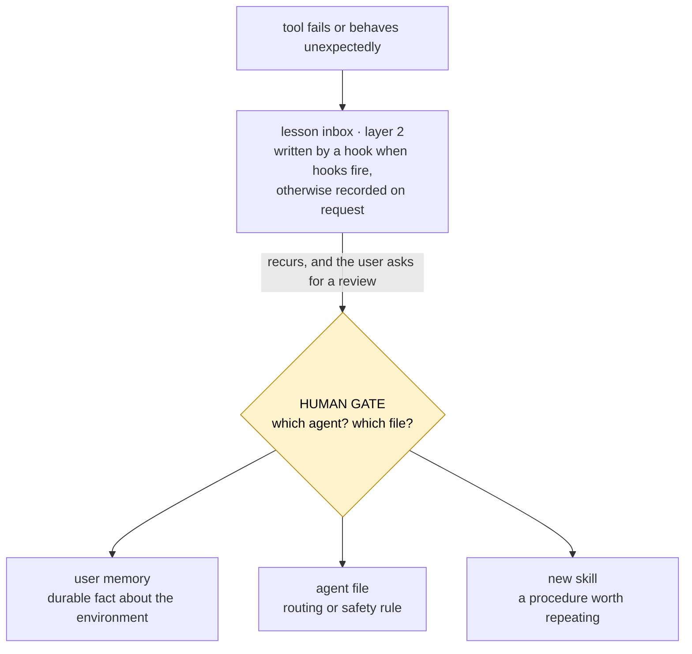

# Architecture

This workspace exists because SAP tooling changes faster than a static instruction set can
follow. It has four layers and one promotion path, and it separates **detecting** a change
from **deciding** what to do about it.

## The four layers

```
┌──────────────────────────────────────────────────────────────┐
│ 1  USER PROFILE      who the user is, how they want to work  │
│    /memories/user-profile.md                                 │
│    Loaded every session. Short by necessity.                 │
├──────────────────────────────────────────────────────────────┤
│ 2  LESSON INBOX      what went wrong, with evidence          │
│    /memories/session/lessons.md                              │
│    Dies with the session. Never edits agents or skills.      │
├──────────────────────────────────────────────────────────────┤
│ 3  AGENT             which tool for which task               │
│    ~/.copilot/agents/*-by-pongg.agent.md                     │
│    Routing, safety gates, evidence rules.                    │
├──────────────────────────────────────────────────────────────┤
│ 4  SKILL             how to perform a recurring procedure    │
│    ~/.copilot/skills/, ~/.agents/skills/                     │
│    frontmatter loads every request; body on demand.          │
└──────────────────────────────────────────────────────────────┘
```

Everything above the line is *loaded*; everything is *scoped* by who owns the file.

## Where each kind of knowledge belongs

| Kind of knowledge | Layer | Why |
| --- | --- | --- |
| Durable preference ("verify, never guess") | 1 | Applies to every task and every agent |
| A fact about this environment ("ADT MCP cannot reach system X") | 1 or repo memory | Small, stable, needed at decision time |
| A dated history or superseded table | archive folder | Needed only when debugging, so keep it out of context |
| A routing rule ("transport release → ARC-1 only") | 3 | Applies to one agent's task family |
| A repeatable procedure ("how to audit the tool surface") | 4 | Long, only needed when invoked |

The failure this design prevents: a rule duplicated in two places. Whichever copy is read
first wins, and the other silently rots. One rule, one home.

## The promotion path



> **Harness caveat (measured 2026-11-13).** In this VS Code build the Copilot harness does not
> fire hooks: `chat.useHooks` and `chat.hookFilesLocations` are documented as Local-harness only,
> while `chat.defaultToCopilotHarness` defaults to `true`. A reload left
> `~/.copilot/state/surface.json`'s `takenAt` unchanged. The layer-2 inbox therefore has two
> producers: the hook when hooks fire, and a manual request otherwise. Keep this caveat until a
> firing is actually observed.

Two properties matter:

1. **Capture is not action.** Recording a failure writes one line. It never edits a rule.
2. **Promotion needs a human.** Detection is automatic; the decision to make a lesson
   permanent is not.

## Ownership

Files are classified by who can safely edit them, not by where they sit.

| Class | How to recognise it | Editing it |
| --- | --- | --- |
| User-owned | filename ends `-by-pongg`; a skill in this kit's `skills/` folder | freely |
| Lock-tracked | listed in `~/.agents/.skill-lock.json` | edits are overwritten by the next `skills update` |
| Installer-owned | listed in `~/.copilot/.sap-ai-dev-toolkit-assets.json` | never; a reinstall replaces the file and stops updating it once modified |

Ownership is decided by **hash comparison against the installer manifest**, not by
judgement. See `ownership.md`.

## Why the agent cannot see its own name

The agent's instructions are in its context, but its display name and its tool inventory
are not reliable facts it can read. That is why the ownership gate asks the user which agent
is active rather than inferring it, and why an allowlist is used rather than a denylist:
an agent installed tomorrow is not delegatable by default, without anyone needing to notice
it appeared.

## Anti-hallucination

The rule set is in `anti-hallucination.md`. The short version: a claim about the environment
needs a tool result from the current session. A hypothesis is allowed when labelled. A guess
stated as fact is not.
